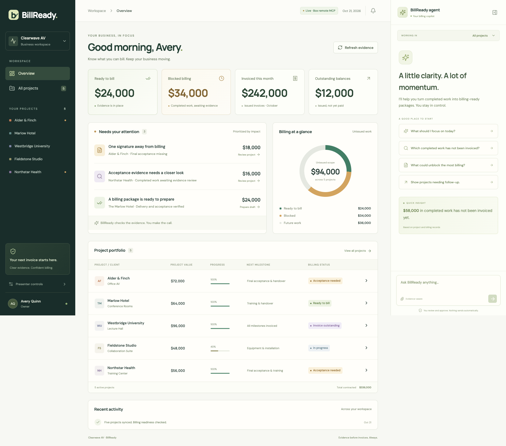
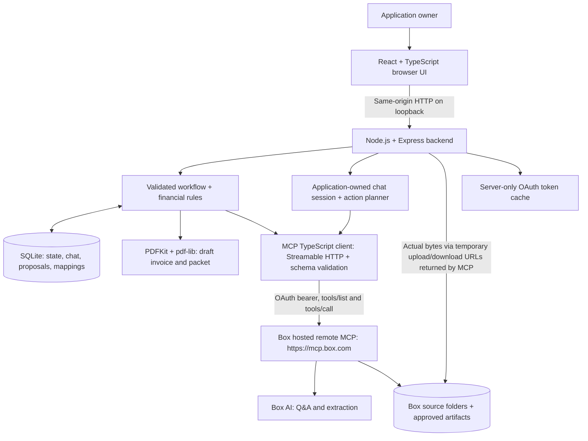
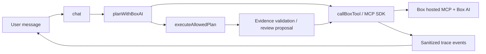

# BillReady

**Turn completed work into an evidence-backed billing package.** BillReady is a billing-readiness application, illustrated with sample data for fictional AV integrator Clearwave AV. It finds completed milestones that are waiting for customer acceptance, validates new evidence, and prepares editable follow-ups, draft invoices, billing packets, and email drafts for review.

The live application uses **Box's hosted remote MCP server at `https://mcp.box.com` and Box AI**. The default live agent needs no OpenAI API key. The included upload kit contains fictional source documents for five projects and a separate presenter acceptance for the main reveal.



## Capabilities

- A portfolio view separates ready-to-bill work, blocked completed work, incomplete future work, and unpaid issued balances.
- An agent chat persists independently for Overview and each project, explains evidence, discovers misplaced acceptance, and proposes actions.
- A real PDF upload can resolve a missing-acceptance blocker after its project, client, milestone, signature, and date are validated.
- A review surface lets the presenter edit recipients, email copy, and attachments and preview the draft invoice.
- Explicit approval saves actual PDFs and email artifacts into the project's Box folders. Retry checkpoints prevent duplicate output files.
- A scoped reset archives recorded rehearsal artifacts and restores the opening scene.

BillReady prepares **drafts**. Saving a package does not issue an invoice, record a payment, send an email, or share a file. Financial calculations and eligibility checks are application code using integer USD cents.

## Technology and architecture

| Layer                    | Technology                                                 | Responsibility                                                                     |
| ------------------------ | ---------------------------------------------------------- | ---------------------------------------------------------------------------------- |
| Browser                  | React 19, TypeScript, Vite 7, Lucide icons                 | Portfolio, project detail, chat, PDF preview, review and approval                  |
| Local backend            | Node.js, Express 5, TypeScript via `tsx`                   | API, OAuth, agent orchestration, validated business actions, file transfers        |
| Workflow storage         | Node built-in SQLite, local filesystem                     | Conversations, proposals, mappings, approval checkpoints, rehearsal content        |
| MCP client               | Official `@modelcontextprotocol/sdk`, Streamable HTTP, AJV | Connect to Box remote MCP, discover tools, validate actual tool schemas            |
| Content and intelligence | Box content platform, Box AI through remote MCP            | Source evidence, acceptance extraction, evidence-based reasoning, approved outputs |
| Documents                | PDFKit, pdf-lib, PDF.js                                    | Generate invoice PDFs, assemble packets, parse synthetic PDFs in rehearsal         |
| Verification             | Node test runner, Playwright with Chrome                   | Domain/adapter checks, complete UI workflow, desktop/mobile rendering              |



The SDK is a **client dependency**, not a replacement Box MCP server. BillReady does not host an MCP server or use the Box Community MCP server. The browser calls the local backend; only the backend authenticates to Box. There is no Box SDK dependency. Ordinary content operations and Box AI calls go through remote MCP. Binary transfers use the temporary Box URLs returned by MCP, as described below.

### Developer walkthrough: follow one request



1. **Connect:** [`BoxMcpClient.open()`](server/box-mcp.ts) creates the official SDK client and Streamable HTTP transport for `https://mcp.box.com`. [`auth.ts`](server/auth.ts) exchanges and refreshes tokens server-side.
2. **Discover tools:** the same `open()` method paginates `client.listTools()`. Schemas come from the connected server. `npm run box:inspect` saves a local snapshot for inspection.
3. **Execute a remote call:** [`callBoxTool()`](server/box-mcp.ts) reuses a validator, then executes **`client.callTool({ name, arguments: args })`** inside `traceCall()`. There are no argument aliases or configurable schema translations. For example, Q&A passes `{ file_ids, question }`; PDF upload URL requests pass `{ parent_folder_id, file_name, file_size_bytes }`.
4. **Interpret the request:** [`planWithBoxAI()`](server/box-agent.ts) sends scoped evidence, current financial facts, and conversation history through `ai_qa_multi_file`. Zod accepts only `answer`, `discover`, `followup`, or `billing` plans.
5. **Enforce the workflow:** [`executeAllowedPlan()`](server/box-agent.ts) checks the project and selects an allowed action. [`reassess()` / `discover()`](server/workflow.ts) validate client, project, milestone, signature, and affirmative acceptance. [`discoveryReply()`](server/discovery-result.ts) reports verified evidence or a remaining blocker. Billing creates a proposal; only the separate owner approval route calls `approve()` to save drafts. Nothing issues an invoice or sends email.
6. **Follow actual activity:** [`traceCall()` / `withTrace()`](server/tracing.ts) capture sanitized parameters, status, timing, and bounded results at SDK execution. [`POST /api/chat/:context/stream`](server/index.ts) streams request-scoped events to [`ToolActivity`](src/ToolActivity.tsx). Transfer events are separately labeled because binary bytes travel to MCP-issued URLs.

[`chat()`](server/agent.ts) is the entry point. Live mode chooses Box AI by default; the optional OpenAI conversation provider remains explicit. Deterministic rehearsal replies live in `chatInDevelopment()` and are never used as a live fallback. [`box-content.ts`](server/box-content.ts) holds scoped file operations; [`adapter.ts`](server/adapter.ts) keeps local development content separate from those live operations.

### How Box MCP is used

On connection, `server/box-mcp.ts` retrieves the actual `tools/list` schemas. Call sites pass explicit arguments matching Box's hosted schemas; AJV compiles each used validator once and reuses it before invocation. Missing tools or unsupported contracts produce errors; live mode does not fall back to simulated success.

| Remote tool                        | Use in BillReady                                                                                                    |
| ---------------------------------- | ------------------------------------------------------------------------------------------------------------------- |
| `get_folder_details`               | Validate the configured root, destination scope, and archive safety                                                 |
| `list_folder_content_by_folder_id` | Paginated recursive inventory, project/folder mapping, write verification                                           |
| `get_file_content`                 | Read structured/text evidence from mapped files                                                                     |
| `ai_qa_multi_file`                 | Default live chat: reason over selected evidence plus authoritative workflow facts and propose a constrained action |
| `ai_extract_freeform`              | Extract acceptance facts from a PDF for application validation                                                      |
| `get_upload_url`                   | Obtain a temporary transfer URL and any single-use upload token for actual PDF bytes                                |
| `upload_file`                      | Save text and JSON artifacts, including email drafts and follow-up records                                          |
| `get_download_url`                 | Obtain a URL for backend PDF preview/download                                                                       |
| `create_folder`, `move_file`       | Archive recorded rehearsal artifacts during an explicit applied reset                                               |

The app accepts one nonzero `BOX_DEMO_ROOT_ID`, requires the root folder name supplied in the upload kit, discovers stable project identifiers `CW-101` through `CW-105`, and maps the five standard subfolders per project. File IDs come from Box responses. Inventory is restricted to that root; hidden files and the dedicated rehearsal archive are excluded. A changed root requires fresh mappings, rather than reuse of IDs from another tree.

**Box AI is not the session store or a general autonomous tool executor.** `server/box-agent.ts` supplies selected source file IDs, recent conversation history, and current financial facts to Box AI Q&A. It validates a returned plan with one action: `answer`, `discover`, `followup`, or `billing`. The application checks the project context and runs the permitted action. Proposals stay local until the user approves saving. Chat cannot approve business outputs or call arbitrary Box tools.

```mermaid
sequenceDiagram
    actor P as Presenter
    participant UI as Browser
    participant App as BillReady backend
    participant MCP as Box remote MCP
    participant Box as Box content / transfer endpoint
    P->>UI: Upload signed acceptance PDF
    UI->>App: PDF bytes + selected project
    App->>MCP: get_upload_url (folder, name, byte size)
    MCP-->>App: Temporary URL and upload token when present
    App->>Box: Multipart upload with actual PDF bytes
    Box-->>App: Actual file ID
    App->>MCP: List destination to verify upload
    App->>MCP: ai_extract_freeform (acceptance facts)
    MCP-->>App: Extracted project, milestone, signature and date
    App->>App: Validate facts and recompute readiness
    App-->>UI: Evidence result and updated amounts
    P->>UI: Request billing package and review draft
    UI->>App: Approve & save
    App->>App: Validate readiness and generate invoice / packet
    App->>MCP: Upload URLs for PDFs; upload_file for email artifacts
    App->>Box: Transfer PDF bytes
    App->>MCP: Verify saved files in mapped Billing folder
    App-->>UI: Persist prepared package and file links
```

PDF transfers include `file_size_bytes` and use a returned single-use upload token only in the transfer authorization header. Download URLs are consumed by the backend. Transfers require HTTPS Box domains; signed URLs and tokens are not exposed in browser application state. A newly uploaded file can remain blocked while Box indexes it; refresh or retry after indexing. Content hashes and stable names support retry without duplicate uploads.

## Quick start: local development

Requirements: **Node.js 24.12 or later**, npm, and a browser. Development and verification used Node.js 26. The kit generator additionally uses the system `zip` utility. Browser tests use installed Google Chrome.

```sh
git clone https://github.com/box-community/billready.git
cd billready
npm ci
cp .env.example .env
npm run dev
```

Open [http://127.0.0.1:4310](http://127.0.0.1:4310). The shipped kit is ready to use; regeneration is optional.

The default `BILLREADY_ADAPTER=development` requires no credentials. It supports real local PDF upload, synthetic-document parsing, persistent state, generated PDFs, and the approval workflow. Chat and tool activity are deterministic and visibly labeled development. This mode is useful for rehearsal; it does not verify remote Box MCP or Box AI access.

For a production build served locally:

```sh
npm run build
npm start
```

Both launch paths bind to loopback. This is a single-company, single-owner local application. Public hosting would require application authentication, deployment hardening, and managed secret storage.

## Live setup: Box remote MCP and Box AI

### 1. Upload the sample documents

Download [BillReady-Box-upload.zip](demo-kit/BillReady-Box-upload.zip), extract it, and upload the extracted root folder to the authorized user's Box account as a folder tree. Preserve its names and structure. Use a dedicated internal application folder without public links or external collaborators.

Copy the root folder ID from its Box URL into `BOX_DEMO_ROOT_ID`. Do not use account root `0`. Do not upload the complete repository, `configuration`, or `presenter-only`. The separate [CW-101 signed acceptance](demo-kit/presenter-only/CW-101-signed-acceptance.pdf) must stay outside the active tree until the live upload scene.

```text
[Uploaded root]/
├── Company/                         # Profile, rules, invoice register
└── Projects/
    ├── CW-101 Alder & Finch/
    ├── CW-102 Marlow Hotel/
    ├── CW-103 Westbridge University/
    ├── CW-104 Fieldstone Studio/
    └── CW-105 Northstar Health/
        ├── 01 Project records/      # Agreement + structured project record
        ├── 02 Delivery evidence/    # Completion report
        ├── 03 Acceptance/
        ├── 04 Billing/              # Approved draft package destination
        └── 05 Follow-ups/           # Approved follow-up destination
```

All five projects have the standard subfolders illustrated under Northstar. Its acceptance is intentionally misplaced in `01 Project records` for the discovery scene.

### 2. Configure the custom Box MCP integration

In Box Admin Console, enable the Box MCP server and create integration credentials under its configuration. Register this exact callback:

```text
http://127.0.0.1:4310/auth/box/callback
```

Enable content read/write and Box AI scopes (`root_readwrite`, `ai.readwrite`) and access to the tools in the table above. `create_folder` and `move_file` may need explicit admin enablement. Doc Gen is not used.

This implementation uses **OAuth authorization-code flow for a signed-in user**. A CCG app is not needed. Put the client ID and secret in your local ignored `.env`, never in the uploaded kit or committed files.

```dotenv
BILLREADY_ADAPTER=live
PORT=4310
DEMO_DATE=2026-10-21
BOX_MCP_URL=https://mcp.box.com
BOX_CLIENT_ID=your_integration_client_id
BOX_CLIENT_SECRET=your_integration_client_secret
BOX_REDIRECT_URI=http://127.0.0.1:4310/auth/box/callback
BOX_DEMO_ROOT_ID=your_uploaded_root_folder_id
AGENT_PROVIDER=box
```

Restart the app. Open [Connect Box](http://127.0.0.1:4310/auth/box/start), or choose **Presenter controls → Connect Box with OAuth**, and sign in with the Box account that can edit the uploaded tree. The backend exchanges the code, validates a one-time expiring state tied to an HttpOnly SameSite cookie, and stores access/refresh tokens in ignored `data/box-oauth.json` with permissions `0600`. Refresh is serialized server-side. If changing the port, update both local and registered redirect URIs.

### 3. Check the connection and preserve the opening scene

```sh
npm run box:inspect
```

This retrieves actual remote schemas into ignored `verification/box-tool-schemas.json`. Open CW-101 and use its project-level **Refresh evidence** to inventory the tree and check that project's evidence.

**Do not refresh all projects from Overview before the opening scene** if you want the initial $34,000 blocked headline: a workspace refresh discovers Northstar's acceptance immediately. The [walkthrough](demo-kit/DEMO_SCRIPT.md) explains the intended order.

Official setup references: [Box MCP setup](https://developer.box.com/guides/box-mcp/setup), [Box MCP tools](https://docs.box.com/en/box-mcp/tools), and [Box OAuth flow](https://developer.box.com/guides/authentication/oauth2/without-sdk). See the [detailed setup guide](demo-kit/SETUP.md) for schema inspection, transfer behavior, and refresh details.

### Configuration reference

| Variable                             | Default / purpose                                                                            |
| ------------------------------------ | -------------------------------------------------------------------------------------------- |
| `BILLREADY_ADAPTER`                  | `development`; use `live` for remote Box calls                                               |
| `PORT`                               | `4310`; backend and browser share this origin                                                |
| `DEMO_DATE`                          | `2026-10-21`; anchors synthetic dates and due dates                                          |
| `BOX_MCP_URL`                        | `https://mcp.box.com`                                                                        |
| `BOX_CLIENT_ID`, `BOX_CLIENT_SECRET` | Local OAuth integration credentials                                                          |
| `BOX_REDIRECT_URI`                   | `http://127.0.0.1:4310/auth/box/callback`                                                    |
| `BOX_DEMO_ROOT_ID`                   | One nonzero uploaded root folder ID; required in live mode                                   |
| `AGENT_PROVIDER`                     | `box`; default live agent uses Box AI via MCP                                                |
| `BOX_MCP_TOKEN`                      | Optional bearer override; takes priority over OAuth cache and does not refresh automatically |
| `DATA_DIR`                           | Defaults to `data/development` or `data/live`; use a fresh store when changing root/identity |
| `OPENAI_API_KEY`, `OPENAI_MODEL`     | Only for optional `AGENT_PROVIDER=openai`; unnecessary for Box AI                            |

The optional OpenAI provider uses Responses API function calling with the same controlled application actions. It is not required for the application and has not been live-verified. The Box AI provider supports the agent chat session by having BillReady persist history and run the action loop.

## Sample scenarios and accounting rules

| Project                      | Opening scenario                                                                   |              Amount |
| ---------------------------- | ---------------------------------------------------------------------------------- | ------------------: |
| CW-101 Alder & Finch         | Completed final milestone, missing signed acceptance; presenter upload resolves it |     $18,000 blocked |
| CW-102 Marlow Hotel          | Completed milestone with acceptance                                                |       $24,000 ready |
| CW-103 Westbridge University | Already issued; remaining unpaid balance                                           | $12,000 outstanding |
| CW-104 Fieldstone Studio     | Delivery incomplete                                                                | $36,000 future work |
| CW-105 Northstar Health      | Completed milestone; acceptance misplaced in project records                       |     $16,000 blocked |

Initial contract value is **$336,000**, with **$242,000 issued**, **$24,000 ready**, **$34,000 blocked**, and **$36,000 future work**. Outstanding **$12,000** is part of issued revenue, not another unissued bucket. Hero acceptance moves $18,000 from blocked to ready ($42,000 ready / $16,000 blocked). Northstar discovery then produces $58,000 ready / $0 blocked. Preparing drafts leaves issued and outstanding totals unchanged.

Acceptance must match the project, client, and milestone; affirm acceptance with a signer and valid date no later than the configured scenario date; and relate to completed delivery. Wrong-project or ambiguous evidence does not unblock billing. All contacts use reserved `.example` addresses. Documents, signatures, register data, and zero-tax assumptions are fictional.

Use the [five-minute walkthrough](demo-kit/DEMO_SCRIPT.md), [ground truth](demo-kit/configuration/ground-truth.json), and [safe reset guide](demo-kit/RESET.md). Changing `DEMO_DATE` requires regenerating the kit and resetting workflow state together; already uploaded Box source documents need corresponding updates or a fresh seed tree.

## Storage, refresh, and reset

Box stores source evidence and approved artifacts. SQLite stores workflow facts, acceptance associations, conversations, local review proposals, stable Box mappings, and approval checkpoints. Financial seed data and the kit's register mirror `server/domain.ts`; this is not a live accounting-system import.

External additions are picked up by **Refresh evidence**; there are no webhooks. Candidates named with `accept` or `handover` are analyzed across project folders, including general records. Content validation determines acceptance. For local rehearsal, place an external PDF in `data/development/external-inbox/CW-101/` and refresh that project.

Reset previews by default. Stop the server before applying it, then restart:

```sh
npm run reset                 # Inspect scope first
npm run reset -- --apply      # Apply to the selected adapter/store
npm run dev
```

Live reset uses remote MCP to archive recorded application-owned files under `BillReady Rehearsal Archive/Rehearsal <timestamp>`. It verifies moves, retains receipts, and does not delete remote files. Original seed sources and their IDs stay in place. The archive is excluded from active evidence. Local state returns to the opening totals, empty proposals, and empty chats. OAuth credentials survive reset. Arbitrary external files are not automatically app-owned; see the [reset guide](demo-kit/RESET.md) before rehearsing external uploads.

## Commands and verification

| Command                  | Purpose                                                                        |
| ------------------------ | ------------------------------------------------------------------------------ |
| `npm run dev`            | Start local backend with Vite and server watching                              |
| `npm run build`          | Type-check and build frontend assets                                           |
| `npm start`              | Serve the built application locally                                            |
| `npm run kit`            | Regenerate source PDFs, presenter PDF, manifests, and upload ZIP               |
| `npm test`               | Domain, PDF, workflow, adapter-schema and transfer-scope tests                 |
| `npm run test:e2e`       | Full Chrome workflow using an isolated development store on port 4311          |
| `npm run test:live-view` | Read-only desktop/mobile rendering of an already running live app on port 4310 |
| `npm run box:inspect`    | Inspect actual authenticated remote tool schemas                               |
| `npm run reset`          | Preview a reset; add `-- --apply` to apply                                     |

The end-to-end test requires installed Google Chrome and a free port 4311. It creates its own `data/e2e` store and does not use the ordinary live application store. The live-view test requires the configured live server and Box access. Utility scripts for targeted live verification and seed-version maintenance live in `scripts/`; these are rehearsal-specific operations, not quick-start requirements. Read them before running, especially scripts that upload or approve artifacts. PDF rendering via `scripts/render-kit.py` additionally requires Python with Pillow and Poppler utilities (`pdftoppm` and `pdfinfo`) on PATH.

The implementation was verified with build/type checks, 25 automated tests, a complete development browser workflow, actual Box OAuth/MCP/Box AI operations, saved-and-downloaded live artifacts, idempotent approval, archive reset, and desktop/mobile rendering. See [verification details and limits](docs/verification.md). Rehearsal transcripts, actual account/folder IDs, downloaded live output manifests, and runtime reports are intentionally excluded from Git.

## Project layout

```text
src/                 React application and styling
server/
  index.ts           Express API and frontend serving
  adapter.ts         Explicit live/development content boundary
  box-mcp.ts         Hosted MCP connection, discovered schemas, callBoxTool
  box-content.ts     Scoped inventory, uploads, archive and transfer helpers
  auth.ts            OAuth authorization and token refresh
  box-agent.ts       Box AI planning and allowed-action execution
  discovery-result.ts Verified discovery replies
  tracing.ts         Request-scoped, sanitized live tool activity
  agent.ts           Agent routing and optional OpenAI provider
  workflow.ts        Evidence validation, proposals, approval and saving
  domain.ts          Project seed, exact-cents financial rules
  store.ts           SQLite state
  pdf.ts             PDF generation and packet assembly
scripts/             Kit generation, reset and inspection utilities
tests/               Unit, workflow, adapter and browser checks
demo-kit/            Upload ZIP/tree, presenter file, manifests and runbook
docs/                Curated verification record and UI screenshots
.env.example         Credential-free configuration template
```

## Inspect live Box MCP activity

Ask a question in the BillReady agent. **Box MCP activity** appears while tools are running, before the answer arrives. Expand any call to inspect the exact parameters sent to Box, bounded result JSON, status, and elapsed time. Use **Details** to expand all calls or **Compact** to scan labels and result counts. Folder/file parameters include links back to Box. Older chat messages retain their original summary-only trace; new calls include detailed payloads.

The browser receives request-scoped server-sent events through `POST /api/chat/:context/stream`. The same trace is saved with the completed answer. Parallel calls remain separate, and another request's activity is excluded. Binary uploads/downloads have their own labels because they use MCP-issued transfer URLs rather than MCP tool invocations. Credentials, authorization values, signed URLs, and binary bodies are removed server-side; long prompts/results are bounded. Prompts and returned document text may still contain business content and are intentionally visible in Details to the local app user.

For a live walkthrough, ask **Find the missing acceptance document**, expand a folder-list call to show its `folder_id` and result count, then inspect the `ai_qa_multi_file` call for selected file IDs and the prompt. Collapse the activity to continue the business workflow.

## Proof upload and client handoff

Uploading acceptance now streams its actual tool calls through `POST /api/projects/:pid/acceptance/stream`. The project view shows save → Box read-back → Box AI extraction → application validation, followed by before/after billing amounts. MCP supplies the file and extracted evidence; BillReady validates the client/project/milestone/signature and computes amounts in integer cents. A final `/api/state` read updates the browser. Failed or mismatched evidence leaves billing blocked. Development mode is explicitly labeled and makes no remote MCP calls.

Tool details present request fields, linked IDs, readable AI instructions, and structured response cards. Raw JSON remains in a separate developer disclosure. The invoice review uses a fitted PDF.js page with zoom and a full-screen link. After approval, **Use saved package** provides document downloads, a copyable email, and **Open email app**. The email-app link supplies text only; the user attaches the downloaded files and sends manually. PDFs remain drafts until finalized and issued in the user's billing system. Nothing sends or issues automatically.

Normal document and attachment lists hide JSON manifests and README/setup files, using customer-friendly names instead. Internal files remain in Box and presenter controls. The backend also rejects technical manifests as customer attachments.

## Troubleshooting

| Symptom                          | Check                                                                                                      |
| -------------------------------- | ---------------------------------------------------------------------------------------------------------- |
| `node:sqlite` unavailable        | Use Node 24.12+; the app relies on Node's built-in SQLite                                                  |
| OAuth redirect fails             | Use `127.0.0.1`, the configured port, and an exactly matching registered callback                          |
| 401 or expired authorization     | Reconnect with OAuth; remove a stale `BOX_MCP_TOKEN` override if present                                   |
| Missing tool / 403               | Check Box MCP enablement, tool permissions, scopes, and the user's access to the configured root           |
| Root/tree validation fails       | Upload the extracted folder intact; configure its root ID, not `0` or a project subfolder                  |
| PDF uploaded but still blocked   | Allow Box indexing, refresh, then inspect project/milestone/signature/date validation                      |
| Initial blocked total is $18,000 | Northstar has already been discovered; follow the scoped reset guide for the opening scene                 |
| New external evidence is absent  | Refresh explicitly, use a descriptive acceptance/handover filename, and keep it inside the configured tree |
| Switched Box root or user        | Use a new isolated `DATA_DIR`; do not reuse prior file ownership/mappings                                  |
| Browser tests cannot launch      | Install Google Chrome; the Playwright configuration uses its `chrome` channel                              |

For the implementation scope and acceptance criteria, see the [original build brief](BILLREADY_BUILD_PROMPT.md).
