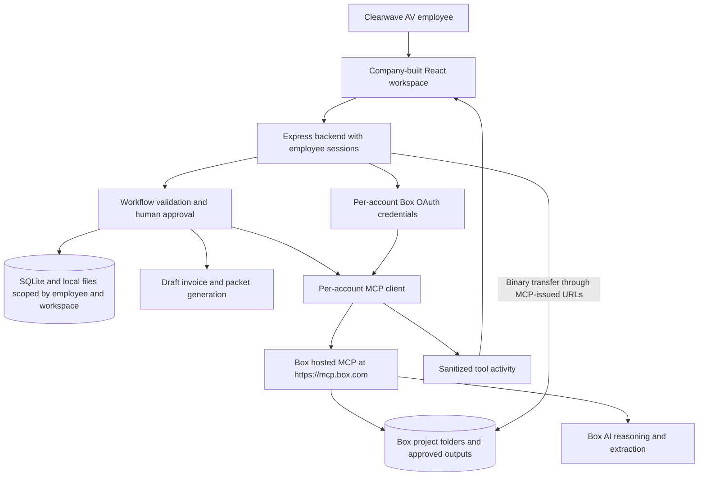
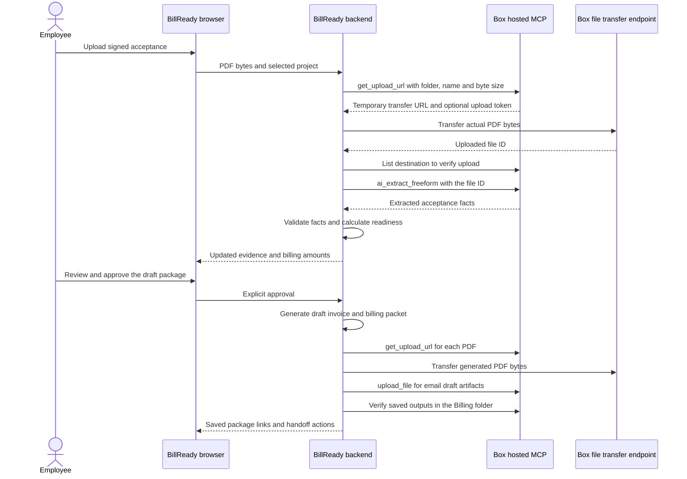

# BillReady · Box MCP demo

**A custom Box workspace built by Clearwave AV engineering for its operations team.** BillReady turns the project documents employees already keep in Box into a visual billing workflow: see completed work, resolve missing acceptance, and prepare an evidence-backed billing package for review.

This repository illustrates how a company can customize its Box experience using **Box’s hosted remote MCP server at `https://mcp.box.com` and Box AI**. Employees sign in with their own Box accounts and choose a workspace folder. Their Box permissions determine which supported projects appear, including shared folders. No OpenAI API key is required for the default agent.

The application prepares drafts. Approval saves documents to Box; employees finalize invoices in their accounting system and send emails themselves.

[Setup](demo-kit/SETUP.md) · [Walkthrough](demo-kit/DEMO_SCRIPT.md) · [Reset options](demo-kit/RESET.md) · [MCP code walkthrough](docs/BOX_MCP_WALKTHROUGH.md) · [Troubleshooting](docs/TROUBLESHOOTING.md) · [Verification](docs/verification.md) · [Public-release review](docs/PUBLIC_RELEASE_REVIEW.md)

Clearwave AV, the customer companies, people and supplied billing documents are fictional demo data. This is a developer sample for a loopback-hosted application, not a production billing service. See [security guidance](SECURITY.md) before using real content.

## What employees can do

- See ready, blocked, future, invoiced, and outstanding amounts for their workspace projects.
- Ask the billing assistant about evidence, find misplaced acceptance, or prepare a review proposal.
- Upload signed acceptance and watch the actual Box MCP activity behind verification and updated readiness.
- Review a fitted PDF invoice, edit email copy and attachments, and explicitly approve saving.
- Open the saved package in Box, download documents, copy the email, or open their email application.
- Change workspace folders, sign out, or switch Box accounts. Different access or folder selections produce different project lists.

## Technology and responsibilities

| Layer                    | Technology                                        | Responsibility                                                                    |
| ------------------------ | ------------------------------------------------- | --------------------------------------------------------------------------------- |
| Employee interface       | React 19, TypeScript, Vite, PDF.js, Lucide        | Workspace, projects, assistant, review, document preview                          |
| Application server       | Node.js, Express, TypeScript                      | Employee sessions, OAuth, validated actions, streaming activity                   |
| Workflow state           | SQLite and restricted local directories           | Separate chats, proposals, mappings, files and checkpoints per employee/workspace |
| MCP client               | Official MCP TypeScript SDK, Streamable HTTP, AJV | Per-account connection to Box’s hosted MCP, actual schema validation              |
| Content and intelligence | Box, Box AI through hosted MCP                    | Project evidence, document extraction and reasoning, saved outputs                |
| Financial/document rules | Application TypeScript, Zod, PDFKit, pdf-lib      | Integer-cent calculations, acceptance validation, draft generation                |



Clearwave’s engineer owns the interface, supported project format, financial calculations, validation, review process, and session storage. Box supplies content access and intelligence through remote MCP. BillReady is a custom application connected to Box; it does not modify the Box web application or host a replacement MCP server. The MCP SDK is a client dependency. Binary bytes travel through temporary URLs issued by MCP.

## Start locally

Clone [box-community/billready-box-mcp-demo](https://github.com/box-community/billready-box-mcp-demo), then open its directory:

```sh
git clone https://github.com/box-community/billready-box-mcp-demo.git
cd billready-box-mcp-demo
```

Requirements: Node.js 26.x (the tested version) and npm. The app uses Node’s built-in SQLite module. Regenerating the upload kit also requires the system `zip` command. Access to this private repository is required to clone it.

```sh
git clone https://github.com/box-community/billready.git
cd billready
npm ci
cp .env.example .env
npm run dev
```

Open [http://127.0.0.1:4310](http://127.0.0.1:4310). The default `BILLREADY_ADAPTER=development` uses fictional sample projects, deterministic assistant replies, and local PDF uploads. It is visibly labeled **Local development** and makes no live Box calls. It does not exercise employee authentication.

For a built frontend served locally:

```sh
npm run build
npm start
```

Both launch paths bind to loopback. Public team deployment requires a separate hosting design, HTTPS cookie settings, managed credential storage, and shared session/coordination infrastructure. Current sessions and cross-account approval locks run within one Node.js process.

## Configure employee Box sign-in

1. Enable Box MCP and create the custom integration credentials in your Box administration environment. Permit the intended employees to use the integration and enable the tools below, including binary URL tools.
2. Register the exact callback `http://127.0.0.1:4310/auth/box/callback`. Scheme, hostname, port and path must match; `localhost` and `127.0.0.1` differ.
3. Set these values in the ignored local `.env`:

```dotenv
BILLREADY_ADAPTER=live
PORT=4310
DEMO_DATE=2026-10-21
BOX_MCP_URL=https://mcp.box.com
BOX_CLIENT_ID=your_custom_integration_client_id
BOX_CLIENT_SECRET=your_custom_integration_client_secret
BOX_REDIRECT_URI=http://127.0.0.1:4310/auth/box/callback
AGENT_PROVIDER=box
```

4. Restart the server, open the application and choose **Sign in with Box**. Each employee completes OAuth using their own Box account. One custom MCP integration client ID and secret serve these individual authorizations; a CCG app is not required. This application uses the admin-generated integration credentials, not a separately hosted MCP server.
5. Browse the employee’s accessible folders, open the desired folder, and select **Use this folder**. For upload and save, the account must already have edit rights to the relevant Acceptance, Billing and Follow-ups folders. Folder selection does not grant or change Box permissions. Account root is available for navigation but cannot be selected as the workflow scope.
6. The app inventories only the selected subtree, reads supported project records, validates acceptance and displays accessible projects. Unsupported records produce warnings; an empty folder stays empty.

The selection is remembered by verified Box user ID. Changing it updates that account’s active workspace across its sessions. Two employees can select the same shared folder; each retains separate local chats and draft proposals. Cross-account approval coordination reuses saved output IDs for the same Box project and milestones.

For BillReady, enable content read/write (`root_readwrite`) and Box AI (`ai.readwrite`). Doc Gen is not used. Tools disabled by the admin will not appear in discovery; visible tools can still fail because of user permissions or entitlement. Treat the connected server’s tool schemas as authoritative.

Official references: [Box MCP setup](https://developer.box.com/guides/box-mcp/setup), [available tools](https://docs.box.com/en/box-mcp/tools), [OAuth authorization-code flow](https://developer.box.com/guides/authentication/oauth2/without-sdk).

### Supported workspace structure

Use the included [Box upload kit](demo-kit/BillReady-Box-upload.zip) or folders following this structure. The selected workspace name is unrestricted; it may contain a subset of the sample projects or other projects following the same record format.

```text
Selected workspace/
├── Company/                         # Optional supporting company documents
└── Projects/                        # Optional grouping folder
    └── Project folder/
        ├── 01 Project records/      # project.json + agreement
        ├── 02 Delivery evidence/    # Completion report
        ├── 03 Acceptance/           # Signed customer acceptance
        ├── 04 Billing/              # Saved billing package
        └── 05 Follow-ups/           # Approved follow-up records
```

`project.json` must contain a unique business `id`, client/name/shortName, contact/email, owner, hex color, progress, and milestones. Each milestone has an ID/name, integer-cent value and paid amount, complete/issued/accepted/acceptanceRequired booleans, and optional issued date. See the [sample record](demo-kit/upload-to-box/BillReady%20Demo/Projects/CW-101%20Alder%20%26%20Finch/01%20Project%20records/project.json) and [`project-record.ts`](server/project-record.ts). The [machine-readable schema](demo-kit/configuration/project.schema.json) is generated from the runtime validator. Milestone IDs must be unique; paid amounts cannot exceed their values, and totals must remain safe integers.

The project folder’s Box ID scopes its internal identity, so the same business code in different workspaces is safe. Duplicate business codes within one workspace are rejected as ambiguous. The application accepts one or more supported projects; it does not require all five samples. Discovery is capped at 150 folders; choose a narrower workspace if needed. Folder listings are paginated, and incomplete scans do not replace the last completed inventory.

The five supplied sample projects use **Alex Chan** as their project owner. That business assignment is separate from the employee’s authenticated Box identity and the Box folder owner. Legacy sample assignments to Alex Chen or Sam Rivera are normalized in app state and imported sample records; existing Box PDFs keep their original text until you replace them.

Keep the [Alder & Finch acceptance PDF](demo-kit/presenter-only/CW-101-signed-acceptance.pdf) outside the active workspace until the upload scene. The broader sample workspace also includes a misplaced Northstar acceptance; initial discovery can verify it immediately. Portfolio totals therefore depend on the accessible projects and actual evidence, rather than a fixed opening number. The [ground-truth scenarios](demo-kit/configuration/ground-truth.json) distinguish the development seed from the fully verified live tree.

## How Box MCP is used

| Hosted MCP tool                      | Application use                                                                                |
| ------------------------------------ | ---------------------------------------------------------------------------------------------- |
| `who_am_i`                           | Verify the signed-in Box user after OAuth                                                      |
| `list_folder_content_by_folder_id`   | Browse folders, inventory selected projects, verify saved files                                |
| `get_folder_details`                 | Check selected scope, project access and destinations                                          |
| `get_file_content`                   | Read structured project records                                                                |
| `ai_qa_multi_file`                   | Reason over selected evidence and authoritative application facts; propose constrained actions |
| `ai_extract_freeform`                | Extract acceptance fields for deterministic application validation                             |
| `get_upload_url`, `get_download_url` | Issue temporary URLs for binary transfer and preview                                           |
| `upload_file`                        | Save text and JSON artifacts in Box                                                            |
| `create_folder`, `move_file`         | Create rehearsal archive batches and move reviewed files during archive reset                  |

`BoxMcpClient` discovers actual `tools/list` schemas, validates explicit arguments, and calls `client.callTool({ name, arguments: args })`. Each employee account has its own connection and token provider. Missing tools, denied access, and unsupported contracts fail visibly; live mode never substitutes simulated success.

For an upload, the server requests an upload URL, transfers actual PDF bytes, verifies the file in Box, and calls Box AI extraction. Application rules check client, business project code, milestone, affirmative acceptance, signer and date before recalculating readiness. The browser receives the result and updated state.



The assistant’s conversation history is application-owned. Box AI proposes only `answer`, `discover`, `followup`, or `billing`; code validates the project and action. Chat cannot approve outputs or invoke arbitrary tools. Approval saves draft PDFs and email artifacts without issuing an invoice, sending email, recording payment, or changing sharing.

Expand **Box MCP activity** beside a chat response or upload to inspect actual tool names, parameters, status, timing, structured results and optional raw JSON. Binary transfers and application validation are separately identified. Tokens, authorization headers, temporary URLs and binary bodies are excluded. Tool details can include business content available to the current employee.

## Sessions, storage and migration

- OAuth state is expiring and browser-bound. Successful authentication creates a fresh opaque session in an HTTP-only SameSite cookie. Sessions expire after eight hours and do not survive a server restart.
- Credentials are stored per verified Box user in `data/employee-auth/accounts.json` with `0600` permissions. Refresh-token rotation is serialized per account.
- Local workflow state/files use `data/employees/<box-user-id>/<workspace-folder-id>/`. Restricted `_receipts` store cross-account approved-output receipts keyed by Box project and milestone; access is verified before reuse.
- Live APIs, streams, previews and downloads require a session. Root/project access is rechecked, downloads go through the current account’s Box authorization, and writes verify their destination. Revoked projects are removed from refreshed local views.
- Sign-out, account switching and folder changes clear browser state and cancel pending client requests. Active server workflows stop at their next session check; a transfer already submitted to Box cannot be undone by signing out.
- The legacy `data/box-oauth.json` and shared `data/live` database are left untouched and are not migrated or used by employee sessions. `BOX_MCP_TOKEN` is disabled and `BOX_DEMO_ROOT_ID` does not select employee workspaces.
- Shared internal folders are supported. Destinations with shared links remain blocked; the app does not create links or change collaborations.

| Configuration                        | Purpose                                                       |
| ------------------------------------ | ------------------------------------------------------------- |
| `BILLREADY_ADAPTER`                  | `development` or `live`                                       |
| `PORT`, `BOX_REDIRECT_URI`           | Local listener and exactly registered callback                |
| `BOX_CLIENT_ID`, `BOX_CLIENT_SECRET` | Server-side custom integration credentials                    |
| `BOX_MCP_URL`                        | Must be `https://mcp.box.com`                                 |
| `AGENT_PROVIDER`                     | `box` by default; optional `openai` needs its own key/model   |
| `EMPLOYEE_AUTH_FILE`                 | Override the restricted per-account credential store          |
| `EMPLOYEE_DATA_DIR`                  | Override per-employee/workspace state and receipt directory   |
| `DATA_DIR`                           | Development/legacy command-line state only                    |
| `DEMO_DATE`                          | Reference date for sample documents and acceptance validation |

## Walkthrough and verification

See the [employee workflow walkthrough](demo-kit/DEMO_SCRIPT.md) and [setup guide](demo-kit/SETUP.md).

```sh
npm test
npm run build
```

Tests include isolated OAuth callbacks, two-account visibility, credential refresh, per-account state and traces, denied ID guesses, permission loss, empty/unsupported workspaces, upload streams, PDF review, repeated approval and shared-project output reuse. These use controlled fixtures, not two real employee accounts. See [verification and limits](docs/verification.md).

## Reset options

| Mode                                 | Entry point                                                                             | Behavior                                                                                                           |
| ------------------------------------ | --------------------------------------------------------------------------------------- | ------------------------------------------------------------------------------------------------------------------ |
| Quick reset after manual Box cleanup | [Quick reset](http://127.0.0.1:4310/#reset-clean) or `npm run reset -- --after-cleanup` | Check Alder & Finch’s relevant folders, then clear local rehearsal state. No Box writes, full-tree scan or Box AI. |
| Archive and reset                    | [Archive reset](http://127.0.0.1:4310/#reset) or `npm run reset`                        | Preview extra rehearsal files, then explicitly approve archiving and workspace restoration through MCP.            |
| Local development                    | `npm run reset`, then `npm run reset -- --apply`                                        | Preview, then restore the development adapter’s local state. Stop its server before applying.                      |

Live commands print an authenticated browser link; even `--apply` does not bypass the browser confirmation. Keep the server running. If OAuth returns you to Overview, reopen the reset link after sign-in.

Quick reset requires a workspace that has already been synchronized. First remove the uploaded proof from Alder & Finch’s `03 Acceptance`, the invoice/packet/email files from `04 Billing`, and generated follow-ups from `05 Follow-ups`. Keep README files and original source records. The app refuses incomplete cleanup. It restores Alder & Finch to **$0 ready / $18,000 blocked**, retains other project amounts and clears workspace chats/drafts. Other sessions using that Box workspace rebuild stale local state on next use.

Archive reset supports the included sample projects. It archives non-baseline files from Acceptance, Billing and Follow-ups, verifies the moves, preserves original source files and credentials, and restores readiness using current file revisions. It does not delete Box files or change sharing. Shared-folder collaborators see those same archive changes. See the [reset guide](demo-kit/RESET.md) for scope and recovery.

First-time discovery can take longer because it lists project folders, reads records and verifies acceptance. Cached reads do not wait behind the mutation queue; project requests check their own project, while overview access checks run in bounded batches. These are scoped checks, not a guarantee that all requests are instant. No live timing benchmark is published.

Use the in-app Box MCP activity viewer to inspect live tools and results. The automated suite uses controlled fixtures; live employee OAuth and folder permissions need verification with authorized Box accounts.

Useful entry points: [`auth.ts`](server/auth.ts), [`context.ts`](server/context.ts), [`box-mcp.ts`](server/box-mcp.ts), [`box-content.ts`](server/box-content.ts), [`workflow.ts`](server/workflow.ts), and [`store.ts`](server/store.ts).

## Contributing and license

See [CONTRIBUTING.md](CONTRIBUTING.md) for development checks and contribution guidance. Licensed under [MIT](LICENSE); third-party dependencies retain their licenses. Box trademarks belong to their respective owners; this sample does not imply endorsement or a support commitment.
