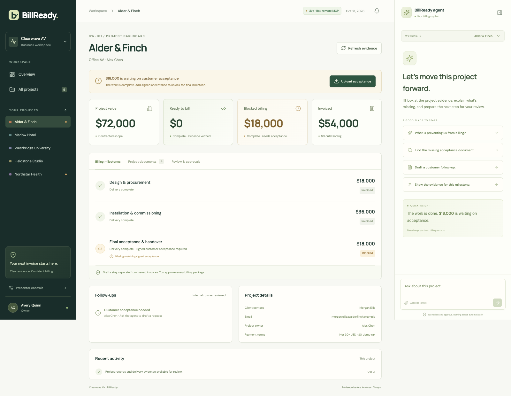
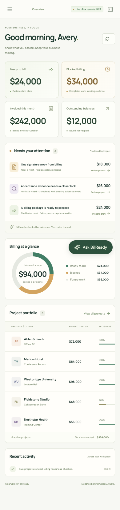

# Verification record

## Authenticated workspace reset — November 4, 2026

- `npm run reset` in live mode exits successfully with the account-bound browser preview link; it does not read legacy credentials or archive files on its own. Local development retains the existing preview/`--apply` behavior.
- All **40 automated tests** pass. Reset tests cover anonymous rejection, selected-folder scope, baseline preservation, stale preview rejection, an interruption after a successful move, retry without losing archived files, restoration of Alder & Finch’s $18,000 blocker, preservation of another Box workspace and sign-in, and invalidation of a collaborator’s local state for the same reset folder.
- Build/type checking passed. Browser fixture verification covered the listed-file preview, archive/reset confirmation, stable completion message and return to the blocked project. Archive/create/move operations used isolated fixtures; no live Box files were moved or deleted while implementing this feature.

## Employee workspaces — November 4, 2026

- `npm test`: **39 passing tests**, including controlled two-account OAuth, separate folder lists, shared project access, single-flight token refresh, scoped SQLite/files/traces, anonymous and cross-account ID rejection, permission loss, empty/unsupported/duplicate project discovery, and interrupted scans retaining the last complete inventory.
- The isolated HTTP workflow exercised acceptance PDF upload with streamed MCP/transfer events, extraction before readiness changes, PDF invoice preview, four saved output artifacts, repeated approval, and two employees approving the same Box project with identical output IDs. These are fixtures; no live Box files were created by them.
- `npm run build` and whitespace checks passed. Browser inspection covered sign-in, folder selection, discovered project counts, project detail, readable MCP parameters/results, fitted invoice review and saved-package handoff. A 390px iframe exercised responsive rendering; this was not a physical mobile-device test.
- A real employee OAuth sign-in succeeded as Chris Kim (`chriskim@boxdemo.com`). The folder browser used that account’s Box content; selecting the existing workspace `429787316757` discovered five project records and validated existing acceptance through hosted Box MCP/Box AI. The result was $58,000 ready, $0 blocked, $242,000 invoiced and $12,000 outstanding, reflecting documents already in Box. Selection does not reset those documents.
- Live assistant verification exposed a business-code versus folder-scoped-ID mismatch. The resolver now accepts a business code only when it uniquely identifies an accessible project; tests verify ambiguity and cross-project rejection. The final live assistant recheck passed after reauthentication: the remembered workspace was restored, `ai_qa_multi_file` completed, and its actual source IDs, instructions, duration and structured response were inspected in the UI.
- Real simultaneous two-account verification remains unavailable without a second authorized employee account. Fixture coverage is not a substitute for that check.
- The legacy shared token file and database were not migrated, reset or assigned to an employee. No Box sharing, deletion or archive operation was performed. Video files and projects were not edited.

BillReady was verified on October 21, 2026 with Node.js 26 and Chrome. These results describe the implementation rehearsal; each new installation still needs its own Box authorization and root configuration. Raw account-specific reports remain local and are excluded from the repository.

## Workflow UX verification — October 29, 2026

- Build and 25 tests pass, including upload SSE parsing, customer document visibility, rejection of technical manifests as attachments, and a fixture proving the MCP upload URL → binary transfer → folder read-back → AI extraction sequence occurs before readiness changes. No live Box content was mutated by these tests.
- Isolated development HTTP upload checks rejected wrong-project proof and accepted matching proof; the new streaming route retained exact totals. Browser checks confirmed the upload progress and before/after amounts, clean attachment choices, and approval transitioning directly into the handoff view.
- The current live saved package was inspected read-only in the browser: customer-facing download/email actions are present, and the complete draft invoice renders in the fitted viewer. Copy/mail-app actions require an explicit user click; launching an external mail application and sending were not automated.
- The fitted viewer is lazy-loaded. Raw JSON is available only in developer trace detail; internal files remain in storage/presenter controls.

## Refactor verification — October 28, 2026

- Current build/type checks and **20 automated tests** passed. Regression tests use isolated temporary stores and fixtures: missing acceptance stays blocked; wrong-project/unsigned evidence cannot unlock billing; matching signed evidence unlocks only its milestone; discovery reports verified state; owner approval and repeated saves remain protected; SDK errors and traces redact credentials; unknown providers and missing live auth fail visibly. Cached-validator and offset-pagination checks passed.
- An isolated development HTTP workflow passed through actual Express routes: missing discovery, wrong-project upload, correct upload and upload retry, review proposal, rejection without explicit approval, four saved draft files, repeated approval without duplicates, and unchanged invoiced/outstanding totals. This is fixture verification, not a live Box mutation test.
- Read-only checks using the refactored official MCP SDK client discovered **51 hosted tools**, called `who_am_i`, verified/listed the configured root, and obtained a Box AI `answer` plan explaining the current $18,000 blocker. No live files were uploaded, moved, deleted, or reset for this refactor. OAuth token refresh remains part of normal authentication.
- The live application and expandable activity panel were inspected in the browser after a new read-only chat request: tool names, timing, selected file IDs, and actual request parameters remain visible. Detailed signed transfer output and failure scenarios are covered by fixtures rather than new live transfers.
- The video project, credential configuration, and Box permissions were not changed. The optional OpenAI conversation provider was preserved but was not exercised against a live OpenAI account in this refactor.

The following sections preserve the earlier implementation verification; they are historical checks, not claims of new live mutation testing.

## Automated checks

- TypeScript checking and Vite production build passed.
- Ten automated tests passed, covering exact-cents reconciliation, acceptance matching, incomplete/issued/duplicate billing protection, generated PDFs, approval idempotency, discovery, external refresh, MCP schema validation, transfer URL scoping, and source linking for a ready seed project.
- A complete Chrome workflow passed in the isolated development store: investigate sources, reject wrong acceptance, edit and save a follow-up, upload correct acceptance, review invoice/email/attachments, approve, reload, retry without duplicates, preview/download, discover misplaced evidence, navigate/search, and inspect mobile chat/layout.
- Read-only live rendering passed at desktop 1600 × 1000 and mobile 390 × 844. The portfolio table scrolls within its card without horizontal page overflow.
- All 14 source/presenter PDFs were rendered and checked as one-page documents. The upload ZIP was checked to exclude presenter acceptance, credentials, dependencies, generated drafts, and runtime state.

## Actual remote Box verification

These checks used real Box OAuth, Box hosted remote MCP, and Box AI, rather than the development adapter:

1. Authorized the authorized user, retrieved 50 actual remote tool schemas, and mapped the scoped five-project tree containing 27 original seed files.
2. Used Box AI Q&A for conversation and freeform extraction for acceptance evidence. Wrong-project acceptance stayed blocked; valid hero acceptance moved $18,000 into ready billing.
3. Prepared and approved an editable follow-up in its mapped Follow-ups folder.
4. Reviewed and saved four actual Billing outputs: draft invoice PDF, assembled packet PDF, email JSON, and email text.
5. Downloaded those saved Box artifacts through the app and confirmed DRAFT, $18,000, $0 tax, Net 30, and required attachments. Reload retained the package; repeated approval created no duplicates.
6. Discovered and validated Northstar's misplaced acceptance, producing $58,000 ready and $0 blocked. Issued remained $242,000 and outstanding remained $12,000.
7. Added a separately tracked acceptance directly through MCP; explicit UI refresh found it without double counting.
8. Updated source PDF versions while preserving original Box file IDs, then archived eight recorded rehearsal artifacts through MCP reset. No remote files were deleted; all original seed IDs remained active.
9. Confirmed reset restored $24,000 ready / $34,000 blocked, no active hero acceptance, empty proposals and conversations, and archive exclusion from evidence.

No check issued an invoice, recorded a payment, sent an email, or created an external share.

## Limits

The optional OpenAI provider has not been live-tested. It is unnecessary for the default Box AI agent. OAuth refresh is implemented and serialized, but a deliberately expired-session refresh was not forced during the rehearsal. External sync is explicit refresh, with no webhook. This application is intended for a single application owner on loopback; multi-user deployment and accounting integrations are outside its scope.

## Rendered application

Mobile overview

